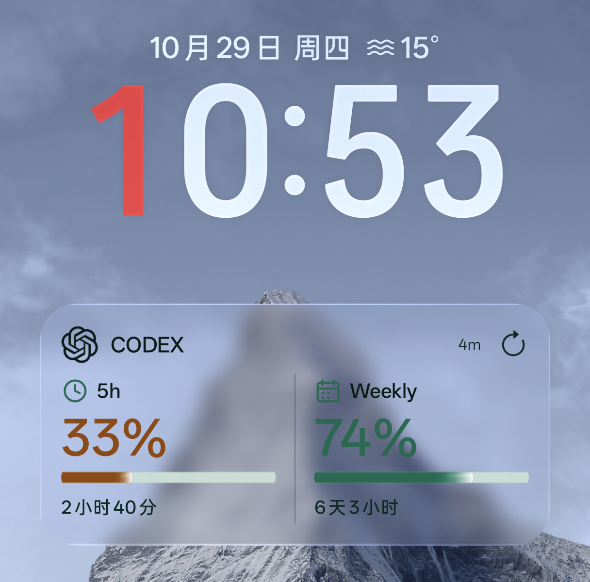
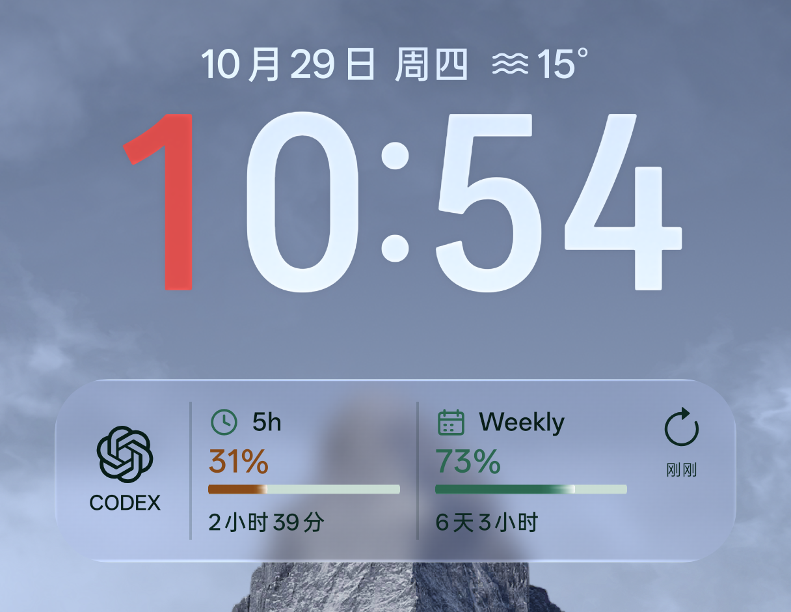
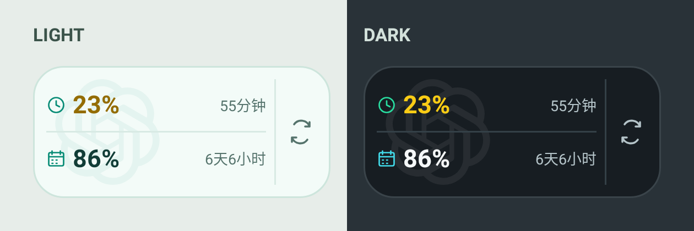
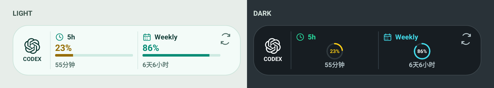
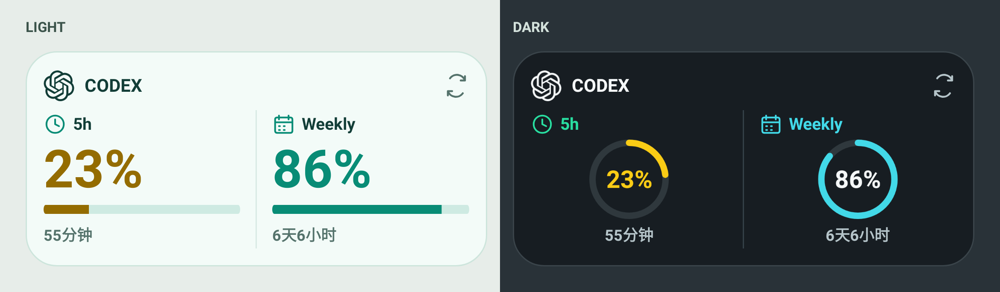
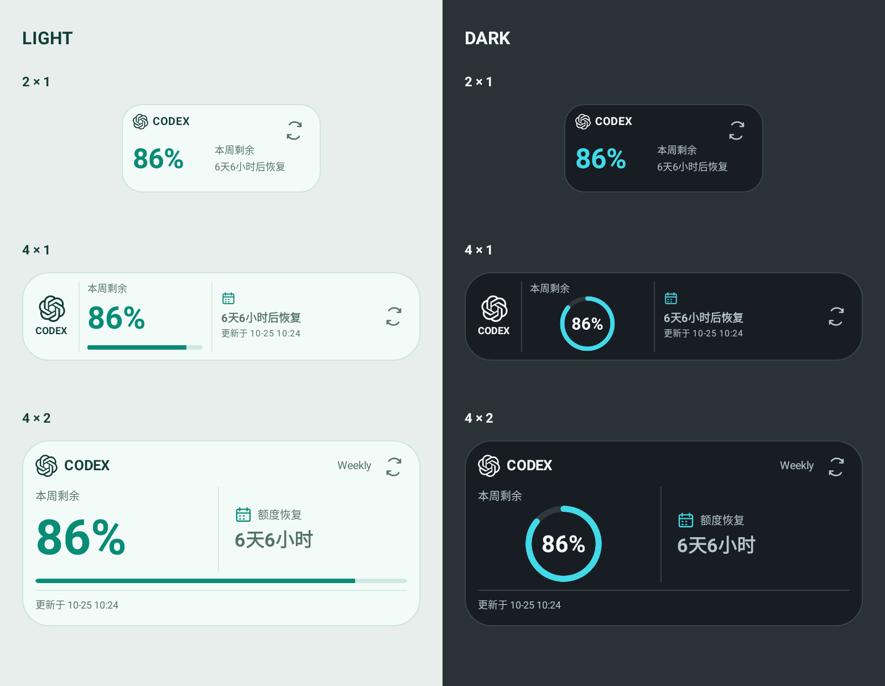

# Codex 余量 · Android

查看 Codex 订阅剩余额度的 Android 应用，提供随系统切换深浅色的桌面小部件。使用原生 Kotlin 开发，支持 Android 16（API 36）及以上。

本项目为第三方客户端，与 OpenAI 无隶属关系。使用 ChatGPT 客户端后端接口，接口及认证格式变化可能影响可用性。

## 功能

- 查看 5 小时、每周及接口提供的附加额度、套餐和恢复倒计时。
- 提供原有和透明玻璃两种桌面小部件，支持 4×2、4×1、2×1，自动适配双周期或仅周额度账号。
- 剩余额度不超过 40% 时显示黄色，不超过 15% 时显示红色；应用和小部件均支持深浅色。
- 支持 Root 读取 ChatGPT 当前登录或终端 Codex 凭据，也可手工导入 `auth.json`。
- 每 15 分钟安排后台查询，支持手动刷新；查询失败时保留缓存，遵守服务端限流。
- 查看重置点数量、到期时间及详情，经确认后使用选定重置点。
- 导入的必要凭据使用 Android Keystore / AES-GCM 加密，禁用备份和设备迁移。

## 下载安装

从 [Releases](https://github.com/JustLookAtNow/codex-usage-android/releases) 下载 `CodexUsage-v版本号-arm64-v8a.apk`，在手机上允许安装该来源的应用后打开 APK。发布包面向 arm64 设备。

更新时使用同一签名的 APK 可覆盖安装并保留数据。由本地 Debug 版本切换到正式 Release 签名时，需要先卸载旧应用；卸载会清除本地凭据、配置和缓存。

## 小部件展示

### 透明玻璃 · 实机效果 NEW

ColorOS 17 + LSPosed 能取得最佳的液态玻璃显示效果。





### 经典风格与布局示例

左侧为浅色模式，右侧为深色模式。额度与倒计时为示例数据；实际格数和间距随手机桌面设置变化。

下图展示原有风格。透明玻璃风格复用相同的尺寸和信息布局，使用半透明背景、渐变与描边，并随系统切换深浅色。适配的 ColorOS 17 系统桌面可通过 LSPosed 启用实时壁纸模糊；未启用时显示半透明背景。

### 2×1 · 极简双行

时钟和周历区分两种额度，GPT 水印居中置于左半部，右侧保留刷新入口。



### 4×1 · 横向紧凑

横向展示两种额度及恢复倒计时，浅色使用进度条，深色使用圆环。



### 4×2 · 双列展示

两列分别展示 5h、Weekly 的额度和倒计时，保留 GPT 标识及刷新入口。



### 仅周额度 · 自动布局

接口返回 Weekly 周期且不包含 5h 周期时，所有已添加的小部件自动采用以下布局；重新出现 5h 周期后自动恢复双周期布局，无需重新添加。5h 周期存在但百分比未知时仍保留双周期布局，附加额度不参与切换。

- 2×1：CODEX 标识、本周剩余百分比、恢复倒计时和刷新按钮，不显示更新时间、进度条或圆环。
- 4×1：品牌、周剩余额度和恢复信息横向排列，浅色使用进度条，深色使用单个圆环，并显示成功更新时间。
- 4×2：突出周剩余额度，配合“本周剩余”“额度恢复”说明，底部显示成功更新时间。

下图展示仅有周额度时三种尺寸的深浅色效果。



## 配置凭据

### Root 自动获取

1. 在手机上的官方 ChatGPT 应用（`com.openai.chatgpt`）中登录账号。
2. 打开本应用，点击“Root 自动查找”，在 Magisk / KernelSU 等权限管理器中允许 Root。
3. 默认选择 ChatGPT 当前登录；未找到时继续查找终端 Codex 的 `auth.json`，多个文件需要手工选择。也可用“Root 自定义路径”指定绝对路径。

自动查找范围：

```text
/data/user/0/com.openai.chatgpt/shared_prefs/com.auth0.authentication.storage.xml
/data/data/*/files/home/.codex/auth.json
/data/user/0/*/files/home/.codex/auth.json
/data/data/*/files/.codex/auth.json
/data/local/tmp/.codex/auth.json
```

ChatGPT 来源还会读取同一应用数据目录中的 `files/datastore/global_session.json`，用于选择当前登录会话。自定义终端目录或 `CODEX_HOME` 请使用自定义路径。

Root 模式只保存来源路径，每次查询重新读取源文件，不修改原始登录或主动续期。凭据失效时，先在 ChatGPT 或终端重新登录，再刷新本应用。后台读取需要 Root 管理器持久授权；ChatGPT 内部认证格式变化时，可改用手工导入。

### 手工导入

点击“手工导入 auth.json”，通过系统文件管理器选择文件，无需 Root 或全盘存储权限。文件通常位于电脑的 `~/.codex/auth.json`，Windows 为 `%USERPROFILE%\.codex\auth.json`。

应用只保存查询所需的 access token 和 account ID，不保存完整认证文件。导入后不会追踪原文件，凭据失效需重新导入。请妥善处理复制到手机公共存储中的原文件。API Key 登录不支持订阅额度查询。

“已手工导入 · 加密保存在本机”下方显示 access token 的过期时间（手机本地时区），从 token 的 `exp` 字段读取；无法读取时显示“未知”。已导入的凭据也会显示，无需重新导入。

## 小部件与后台刷新

点击应用内“添加原有小部件”或“添加透明玻璃小部件”，也可以长按桌面，从小部件列表选择“Codex 余量”或“Codex 余量 · 透明玻璃”。两种小部件可以同时添加，默认 4×2，可拖动边界调整为 4×1 或 2×1，实际尺寸取决于桌面网格。所有实例共用同一账号和缓存。

- 在已安装支持 API 102 的 LSPosed 的 ColorOS 17 设备上，可启用本应用的模块，将作用域设为系统桌面 `com.android.launcher`，并重启桌面，为透明玻璃小部件启用实时壁纸模糊。透明玻璃小部件添加按钮下方会突出显示模块服务连接与系统桌面作用域状态；连接和作用域状态不代表桌面已重启或真实模糊已经生效。没有连接时，可能是未启用模块、框架不兼容等原因，必要时重启应用。该功能依赖桌面的内部接口，系统更新后可能需要重新适配；未启用或不兼容时仍显示半透明背景。
- 透明玻璃小部件在任一周期剩余额度不超过 10% 时显示红色底部光晕；4×1、4×2 的进度条或圆环末端带有与额度颜色一致的柔和光晕。
- 点击 2×1 小部件的百分比数字、4×1 分割线左侧的品牌区域，或 4×2 的 GPT 图标和 CODEX 文字，打开手机里的 ChatGPT；未安装时打开本应用。点击其他主体区域打开本应用，点击刷新图标查询额度。刷新期间额度保持清晰可见，刷新图标原地旋转。查询失败时保留上次的额度，刷新图标变为橙黄色，成功后恢复原色。
- 仅周额度账号自动切换单周布局，重新出现 5 小时额度后自动恢复双周期布局，无需重新添加。
- 倒计时在本地按分钟更新，不额外请求接口。恢复时间到期时显示“0分钟”，不会推算额度已恢复。
- 单周 4×1、4×2 显示最近成功查询时间，本地倒计时更新不改变该时间。查询失败保留旧数据，并提示缓存或失败状态。
- 后台查询由 WorkManager 每 15 分钟安排；休眠、省电策略及桌面刷新机制可能延迟查询或倒计时更新。

联网使用手机当前网络，包含 VPN。应用保留 TLS 校验并拒绝重定向，不提供独立 HTTP/SOCKS 代理。

## 重置点

额度卡片显示可用重置点数量及到期时间，点击“展开重置点详情”查看明细。时间按手机本地时区显示，接口缺失字段显示“未提供”；可用数量以服务返回值为准。

点击某项右侧的“使用”并确认后，应用会重新查询并检查该项是否可用，再发送使用请求。**成功使用重置点后不可撤销**，可重置的额度周期由服务决定。后台刷新只查询，不使用重置点。

遇到超时或结果未知时，点击“重试本次重置”复用已保存的请求编号，避免重复消耗。待确认请求绑定原账号和所选重置点；确认结果前不能使用其他项目。更换账号后不可重试原账号请求，重新配置或清除凭据会删除待确认状态。

## 隐私与限制

- 应用仅连接 `https://chatgpt.com/backend-api/wham/`，不提供云端同步，不记录凭据或原始响应。
- 手工导入的必要凭据保存在应用私有存储中并加密；Root 模式只读原始文件。
- 清除凭据会停止后台任务，删除额度缓存和待确认重置请求。
- 当前支持单账号，不提供网页登录或 token 自动续期。退出原客户端不会自动清除已手工导入的副本。
- 各厂商 Root 管理器、桌面和省电策略不同，可能影响读取、显示或后台刷新。

## 构建与测试

需要 JDK 21、Android SDK Platform 37.0、Build Tools 36.0.0。Gradle Wrapper 固定为 9.3.1，Android Gradle Plugin 为 9.1.1，无需单独安装 Gradle。

使用 Android Studio 打开项目，或设置 `ANDROID_HOME` 后执行：

```sh
./gradlew testDebugUnitTest lintDebug assembleDebug
adb install -r app/build/outputs/apk/debug/app-debug.apk
```

Debug APK 位于 `app/build/outputs/apk/debug/app-debug.apk`。测试及 Lint 报告位于 `app/build/reports/`。

单元测试使用 JUnit 和 Robolectric，覆盖凭据解析及加密、Root 读取、额度查询、限流与失败缓存、重置请求重试、小部件布局和后台调度。测试使用虚构凭据和本地响应，不连接真实账号或消耗重置点。Root 授权、系统文件选择器、Android Keystore、桌面和省电策略仍需真机验证。

## 持续集成与发布

PR、推送 `main` 或手动运行 `Android` 工作流时，自动执行单元测试、Lint 和 Debug 构建，提供 APK 与检查报告附件。PR 检查无需签名密钥。

维护者首次发布前，需生成并妥善备份固定的 Release 签名密钥，在仓库 Actions Secrets 中配置：

| Secret | 内容 |
| --- | --- |
| `ANDROID_KEYSTORE_BASE64` | JKS 签名文件的 Base64 编码 |
| `ANDROID_KEYSTORE_PASSWORD` | 签名文件密码 |
| `ANDROID_KEY_ALIAS` | 密钥别名 |
| `ANDROID_KEY_PASSWORD` | 密钥密码 |

可通过 `keytool -genkeypair -keystore release.jks -storetype JKS -alias release -keyalg RSA -keysize 3072 -validity 10000` 交互生成密钥。使用 `gh secret set` 从文件或标准输入上传，避免将密钥或密码提交到仓库。签名密钥及密码需要长期备份，后续覆盖升级必须使用同一密钥；本机 `.release-signing/` 目录已被 Git 忽略。

提交消息作为该版本更新日志，包含标题及正文。例如：

```sh
git tag v1.0.0
git push origin v1.0.0
```

只有将 tag 推送到 GitHub 才会触发发布。`Release` 工作流先测试和 Lint，再构建、签名并上传 arm64 APK；失败时停止发布。同一 tag 重跑会更新对应 Release 和附件。

版本规则：tag 必须为 `v主版本.次版本.修订版本`，不带前导零或预发布后缀。APK 的 `versionName` 去掉 `v`；`versionCode = 主版本 × 1,000,000 + 次版本 × 1,000 + 修订版本 + 1`，次版本和修订版本均不超过 999，最终值不超过 2,100,000,000。升级时应递增版本。

更新日志始终来自 tag 对应提交的完整 commit message；annotated tag 的说明不参与生成。发布构建通过 `-PreleaseVersionName`、`-PreleaseVersionCode` 和 `-PtargetAbi=arm64-v8a` 传入版本及架构，签名由 `RELEASE_KEYSTORE_PATH`、`RELEASE_STORE_PASSWORD`、`RELEASE_KEY_ALIAS`、`RELEASE_KEY_PASSWORD` 环境变量提供。
